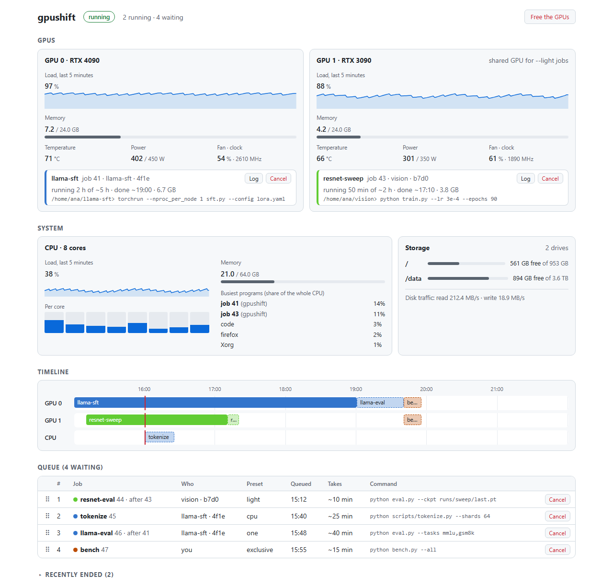

# gpushift

[](https://github.com/EdwardGlockner/gpushift/actions/workflows/ci.yml)
[](https://pypi.org/project/gpushift/)


[](LICENSE)

Share one GPU machine between your Claude Code agents and yourself. Agents queue
their GPU work instead of launching it, so they never crash each other's runs, and
the queue steps aside when you start a game or Blender.

- **One queue for every session.** A Claude Code hook stops agents that launch
  training directly and tells them how to queue it.
- **The machine is still yours.** Free the GPUs with one command, or just start a
  game: running jobs save a checkpoint and step aside, and carry on afterwards.
- **No idle GPUs.** Jobs run in the order they were queued, but short jobs may fill
  a GPU that would otherwise sit idle, and small jobs share a GPU.
- **You stay informed.** Agents hear when their jobs end, you get a desktop
  notification when one fails, and a local dashboard shows everything.
- Windows, Linux and macOS, any number of NVIDIA GPUs. No configuration needed.

<picture>
  <source media="(prefers-color-scheme: dark)" srcset="https://raw.githubusercontent.com/EdwardGlockner/gpushift/main/docs/img/gpushift-dark.svg">
  
</picture>

## Quickstart

```bash
uv tool install gpushift   # or: pipx install gpushift
gpushift init              # detects your GPUs and starts gpushift (also at login)
```

Then, in Claude Code:

```text
/plugin marketplace add EdwardGlockner/gpushift
/plugin install gpushift@gpushift
```

That's it: agents now queue their GPU work. You can queue jobs too:

```text
$ gpushift submit --one --eta 40m -- python train.py
job 14 queued (one: 1 GPU, 2 slots) tag=resnet
position 2 of 3, estimated start: ~40m (14:52)
```

## Dashboard

`gpushift ui` opens a live dashboard in your browser: what runs on each GPU, CPU and
disk usage, a timeline of what runs when, the queue (drag jobs to reorder them) and
each job's output. `gpushift status` shows the same in the terminal.

<picture>
  <source media="(prefers-color-scheme: dark)" srcset="https://raw.githubusercontent.com/EdwardGlockner/gpushift/main/docs/img/gpushift-dashboard-dark.png">
  
</picture>

## Submitting jobs

Pick how much of the machine a job needs:

| Preset | For | Gets |
|---|---|---|
| `--light` | Small evals and inference | Shares one GPU with other light jobs |
| `--one` (default) | Most jobs | One GPU |
| `--two` | Multi-GPU training | All GPUs |
| `--exclusive` | Benchmarks | The whole machine |
| `--cpu` | Preprocessing | No GPU |

Useful options:

- `--eta 40m`: how long the job takes, for better start times. Without it, gpushift
  learns from earlier runs of the same command.
- `--after 12`: start only once job 12 has succeeded, e.g. an eval after its
  training run. Use this whenever order matters; otherwise jobs may run side by side.
- `--restartable`: the job is safe to stop and run again from the start.

Jobs run in the folder and environment you submitted them from (including your
virtualenv), on the GPUs gpushift picked for them. See `gpushift submit --help` for
everything else.

## When you need the GPUs

```bash
gpushift free      # pause the queue and clear the GPUs
gpushift resume    # carry on
```

Jobs that can save a checkpoint do so and resume later, restartable jobs start over
later, and other jobs are paused in place (they keep their GPU memory). Only you can
free or resume; agents can't.

gpushift also does this on its own: when a program you started uses the GPU heavily
(a game, Blender, your own training), it frees the GPUs, and it resumes two minutes
after that program closes.

## Claude Code plugin


- **A skill** that teaches agents to queue GPU work and pick sensible options.
- **A hook** that blocks direct GPU launches (`python train.py`, `torchrun`,
  `accelerate launch`, ...) and shows the agent how to queue them instead. Add
  `# no-queue` to a command to let it through.
- **Wake-ups**: agents run `gpushift wait` in the background, so a session hears
  when its jobs end, even if it was idle.
- **Commands**: `/gpushift:queue`, `/gpushift:priority`, `/gpushift:cancel`,
  `/gpushift:free` and `/gpushift:resume`.

Not using the plugin? Add this to your `CLAUDE.md`:

> Never launch GPU jobs directly; submit them with `gpushift submit` (`gpushift submit --help`, `gpushift status`).

## Making jobs resumable

So that freeing the GPUs doesn't cost progress, let your training loop check whether
gpushift wants it to stop, and save a checkpoint when it does:

```python
from gpushift import checkpoint as ckpt

last = ckpt.latest_checkpoint("checkpoints", "step*.pt")  # None on a fresh start
step = load(last) if last else 0
while step < total:
    train_step()
    step += 1
    if ckpt.should_stop():
        with ckpt.atomic_path(f"checkpoints/step{step:08d}.pt") as tmp:
            torch.save(state, tmp)
        break  # gpushift requeues the job and resumes it later
```

It has no dependencies and works in any environment. Examples for
[PyTorch](examples/pytorch_resumable.py), [HF Trainer](examples/hf_trainer_resumable.py)
and [Lightning](examples/lightning_resumable.py).

## Commands

| Command | |
|---|---|
| `gpushift submit [preset] -- <cmd>` | Queue a job |
| `gpushift status` / `gpushift ui` | See what's running and waiting |
| `gpushift logs <id> -f` | Follow a job's output |
| `gpushift wait [<id>]` | Wait for a job (or the next of your jobs) to end |
| `gpushift cancel <id>` / `gpushift retry <id>` | Cancel a job / run it again |
| `gpushift priority <id>` | Move a job to the front |
| `gpushift free` / `gpushift resume` | Free the GPUs / carry on |
| `gpushift config --edit` | Change settings |

`gpushift --help` lists the rest.

## Configuration

Nothing needs configuring. To change something, run `gpushift config --edit`: the
file explains every setting, such as which GPUs to use, which programs count as a game,
the dashboard port, and whether Claude sessions take turns instead of first come,
first served.

## How it works

A small background service per user keeps the queue in a local SQLite database and
starts each job when its GPUs are free. It recovers after crashes and reboots, and
the queue keeps its place even while the service is stopped. Its state lives in
`%LOCALAPPDATA%\gpushift` (Windows), `~/.local/state/gpushift` (Linux) or
`~/Library/Application Support/gpushift` (macOS).

## Development

```bash
pip install -e ".[dev]"
pytest
ruff check . && ruff format --check .
```

The tests run a real queue on fake GPUs, so they don't need a GPU.
