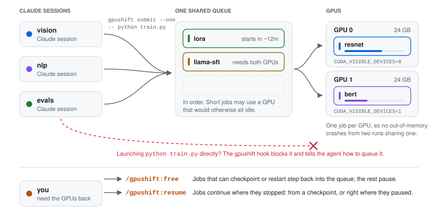
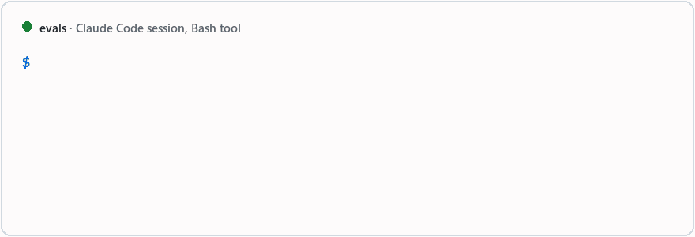

# gpushift

[](https://github.com/EdwardGlockner/gpushift/actions/workflows/ci.yml)


[](LICENSE)

Share one GPU machine between your Claude Code agents and yourself. Agents queue
their GPU work instead of launching it, so they never crash each other's runs;
jobs run in the order they were queued, share a GPU when they fit, and step aside when you start a game
or Blender, then carry on when you're done.

- **One queue for every session.** A Claude Code hook stops agents that launch
  training directly and tells them how to queue it.
- **The machine is still yours.** `/gpushift:free` (or just starting a heavy GPU
  program) makes running jobs save a checkpoint and step aside; they resume later.
- **Efficient.** First come, first served, but short jobs fill idle GPUs or go
  ahead of long ones when that cuts everyone's waiting, and jobs whose memory use
  is known share a GPU.
- **You stay informed.** Agents are told when their jobs end, you get desktop
  notifications for failures, and a web dashboard shows everything.
- Windows, Linux and macOS, any number of NVIDIA GPUs (or none). No configuration.

<picture>
  <source media="(prefers-color-scheme: dark)" srcset="https://raw.githubusercontent.com/EdwardGlockner/gpushift/main/docs/img/gpushift-dark.svg">
  
</picture>

## Quickstart

```bash
uv tool install gpushift          # or: pipx install gpushift
gpushift init                     # detect GPUs, write the config, start the daemon (and at login)
```

Then, in Claude Code:

```text
/plugin marketplace add EdwardGlockner/gpushift
/plugin install gpushift@gpushift
```

Agents now queue their GPU work. You can too:

```text
$ gpushift submit --one --eta 40m -- python train.py --epochs 90
job 14 queued (one: 1 GPU, 2 slots) tag=resnet
position 2 of 3, estimated start: ~40m (14:52)
logs: gpushift logs 14 -f
```

`gpushift status` (or `gpushift ui` for the dashboard) shows what runs where,
what waits, and when it should start:

```text
gpushift  mode: normal  |  daemon: running  |  slots: 4/4 used

GPU 0 GTX 1070         6.1/8.0 GB            job 12   one       resnet          1h02m  python train.py --cfg a.yaml
GPU 1 GTX 1060 6GB     2.3/6.0 GB   (shared) job 15   light     eval              3m  python eval.py --ckpt last.pt
                                             job 16   light     eval              1m  python eval.py --ckpt best.pt

Queue (2 waiting)
  pos  id   preset    tag            waiting  est. start           command
    1  17   two       llama-sft          12m  ~40m (14:52)         torchrun --nproc_per_node 2 sft.py
    2  18   cpu       data                3m  ~41m (14:53)         python tokenize.py
```

## Submitting jobs

| Preset | Use for | Gets |
|---|---|---|
| `--light` | Small evals/inference that fit in a fraction of VRAM | Shares the *shared GPU* with other light jobs, never with a training run |
| `--one` (default) | A normal single-GPU job | 1 GPU (a whole one, unless its memory need is known; see below) |
| `--two` | Multi-GPU (DDP, torchrun) | All GPUs gpushift manages |
| `--exclusive` | Benchmarks, jobs that need the whole box | Everything; nothing else runs alongside |
| `--cpu` | Preprocessing, CPU-only work | No GPU (`CUDA_VISIBLE_DEVICES=""`) |

Options:

- `--eta 40m`: how long it takes. Gives better start estimates and lets the job use
  idle GPUs (below). Without it, gpushift learns from earlier runs of the same command.
- `--vram 6G`: GPU memory it needs, so it can share a GPU. Also learned from earlier runs.
- `--restartable`: safe to stop and run again (it skips finished work); see free mode.
- `--after 12` (or `--after 12,13`): start only once those jobs finished successfully,
  e.g. an eval after its training run. Until then it doesn't hold anything else up; if
  one of them fails or is cancelled, this job is cancelled too. Use it whenever order
  matters: queue order alone doesn't make jobs run one after another (two jobs can run
  side by side on two GPUs). A job can't be moved ahead of a job it waits for.
- `--priority` (front of the queue), `--tag`, `--gpus N` / `--slots N` (override the preset).

The job runs with the **cwd and environment of the submit call** (your venv/conda
env, env vars), with `CUDA_VISIBLE_DEVICES` set to its GPUs and
`CUDA_DEVICE_ORDER=PCI_BUS_ID`, so GPU numbers match `nvidia-smi`. Give the command
as separate words, or as one quoted string to run it in a shell: on Windows, the Git
Bash it was submitted from (what Claude Code's Bash tool uses), or cmd.exe if it uses
backslash paths or comes from cmd/PowerShell; `/bin/sh` on Linux and macOS. A
missing program or script is rejected right away, not when the job starts.

## How jobs are scheduled

**First come, first served.** Jobs start in the order they were queued. Jobs moved
up with `--priority` / `gpushift priority`, and evicted jobs waiting to resume, go
first. With `fair_share = true`, Claude sessions (and you, from a terminal) take
turns instead: the next job comes from whoever has used the least GPU time in the
last 24 hours, so one session's list of thirteen jobs doesn't hold up everyone else.

**Sharing GPUs.** A job whose memory need is known (`--vram`, or the peak of earlier
successful runs of the same command plus 15%) can share a GPU with other such jobs,
as long as they fit in what's left of its memory. Shared GPUs fill up first, so
whole GPUs stay free for jobs that need one. Jobs with an unknown need always get a
whole GPU. `packing = false` turns this off.

**No starvation, no idle GPUs.** A job waiting for several GPUs never starves behind
a stream of small ones: it holds back the jobs behind it. They may still use a GPU
that would otherwise sit idle, if their estimate says they finish before the
waiting job could start anyway. When a running job is past its estimate, nobody
knows when it ends, so then nothing jumps ahead.

**Short jobs before long ones, within limits.** Strict order can leave a GPU idle
for hours: a 4-hour one-GPU job starts, and a batch of 15-minute whole-machine jobs
queued after it waits for it. Before starting anything, gpushift
forecasts the queue and checks whether running some jobs ahead of their turn cuts
the total waiting. It does that only if no job starts more than an hour (or half its
own run time, if that is longer) later than it would in queue order, counted from
the first time it was passed, and never for jobs moved up with `--priority`. Equal
jobs keep their order. `reorder_slack` sets the hour; 0 turns this off.

**Slots** are the machine's concurrency budget (default: 2 per GPU). `--light`,
`--cpu` and GPU-sharing jobs use 1, `--one` and `--two` use 2, `--exclusive` all.

**GPUs used outside gpushift**: an unclaimed GPU only counts as free if at least
`gpu_free_perc` (default 75%) of its memory is free.

## When you need the GPUs

```bash
gpushift free      # pause the queue and clear the GPUs (/gpushift:free in Claude Code)
gpushift resume    # carry on                            (/gpushift:resume)
```

`free` pauses the queue, then:

- **Resumable jobs** (they use `gpushift.checkpoint`, below) save a checkpoint, exit and
  go back to the front of the queue. A job that doesn't exit within `evict_timeout`
  (300 s) is frozen instead.
- **Restartable jobs** (`--restartable`) are stopped and go back to the front, to run
  again. Use it for jobs that skip work they already finished, like most eval scripts.
- **Other jobs are frozen.** They stop computing but keep their GPU memory, and `free`
  says which GPU they hold and how to release it.

`free --soft` freezes everything instead (instant, but all GPU memory stays in use).
Free mode survives reboots. Agents can't run `free` or `resume`; only you can.

**Automatically.** When a program you started yourself uses the GPU heavily (a game,
Blender, your own training script), gpushift frees the GPUs after 10 seconds and
resumes two minutes after the last such program closes. "Heavily" means over 1 GB of
GPU memory, or any use by a program you list in `[auto_free] apps`; the desktop,
browsers and chat apps are ignored. A free you start by hand is never resumed for you,
and if you resume by hand, gpushift waits for the program to close before freeing again.

## Notifications and the dashboard

- **Agents are told when their jobs end.** The plugin adds a short note to the session
  that submitted the job ("job 34 (r2-trial) failed: exit code 2 after 0s: can't open
  file ...") on its next step, so agents don't need to poll.
- **Desktop notifications** for failed jobs and automatic free/resume
  (`[notify] desktop = "all"` for every job, `"off"` for none).
- **`gpushift ui`** opens a live dashboard at `http://127.0.0.1:8237`: GPUs and their
  memory, load, temperature and power, the CPU, free space on each drive, a timeline
  of what runs on which GPU and when, running jobs and their logs, the queue (drag a
  job by its handle to move it), recent results with failure reasons, and buttons to
  free/resume or cancel. It only listens on your own machine.

## Commands

| Command | |
|---|---|
| `gpushift submit [preset] [options] -- <cmd>` | Queue a job (`--json` for machine output) |
| `gpushift status [--json]` | GPUs, running jobs, queue, estimated starts, mode |
| `gpushift ui` | Open the web dashboard |
| `gpushift logs <id> [-f] [-n N]` | Job output |
| `gpushift wait <id> [--timeout 30m]` | Block until the job ends; exit code mirrors the job |
| `gpushift show <id>` | One job's details |
| `gpushift priority <id>` / `gpushift swap <a> <b>` | Reorder the queue |
| `gpushift cancel <id>...` / `gpushift retry <id> [--priority]` | Cancel / queue a copy |
| `gpushift free [--soft]` / `gpushift resume` | Free the machine / continue |
| `gpushift init` / `gpushift doctor` / `gpushift config [--edit]` | Setup, health check, config |
| `gpushift start` / `gpushift stop` / `gpushift autostart on\|off` | Daemon control |

`gpushift status --json` has a stable schema (`"schema": 1`) for scripts and agents.

## Claude Code plugin



- **Skill `gpu-queue`**: never launch GPU work directly; how to pick a preset; check
  `gpushift status` first; give an ETA and memory need; `--restartable` for jobs that
  can rerun; `--priority` only when the user asks; never free/resume; make new
  training scripts resumable; keep working while jobs run.
- **Slash commands**: `/gpushift:queue`, `/gpushift:priority <id>`, `/gpushift:cancel <id>`,
  `/gpushift:free [--soft]`, `/gpushift:resume`.
- **Hooks**: before a Bash/PowerShell command, block direct GPU launches and show the
  `gpushift submit` command to use instead; after each step, tell the session about
  its jobs that ended.
  - Blocked: `python train*.py` / `finetune*` / `pretrain*` / `*_train.py` /
    `python -m pkg.train`, `torchrun`, `accelerate launch`, `deepspeed`,
    `python -m torch.distributed.*`, and `CUDA_VISIBLE_DEVICES=… python …`, also
    behind `uv run`, `conda run`, `nohup` and `&&` chains.
  - Never blocked: commands through `gpushift`, `python -c`, `--help`, pytest, pip,
    editors, and text that only mentions a command (commit messages, echo, grep).
  - Escape hatches: append `# no-queue` (or prefix `GPUSHIFT_NO_QUEUE=1`); regexes in
    `[hook] allow` / `deny`; `[hook] enabled = false`. It's a guardrail, not a
    security boundary.

Not using the plugin? Add this to your `CLAUDE.md`:

> Never launch GPU jobs directly; submit them with `gpushift submit` (`gpushift submit --help`, `gpushift status`).

## Making jobs resumable: `gpushift.checkpoint`

A dependency-free helper. Every gpushift job can import it, even in an environment
where gpushift isn't installed.

```python
from gpushift import checkpoint as ckpt

last = ckpt.latest_checkpoint("checkpoints", "step*.pt")  # None on a fresh start
step = load(last) if last else 0
while step < total:
    train_step()
    step += 1
    if step % 1000 == 0 or ckpt.should_stop():
        with ckpt.atomic_path(f"checkpoints/step{step:08d}.pt") as tmp:
            torch.save(state, tmp)  # never leaves a half-written checkpoint
    if ckpt.should_stop():
        break  # exit 0 -> gpushift requeues and resumes it
```

- `should_stop()`: call it every step (it's cheap). The first call also marks the job
  as resumable, so `free` evicts it instead of freezing it.
- `resuming()`: True when gpushift restarted the job after an eviction (`GPUSHIFT_RESUME=1`).
- `latest_checkpoint(dir, pattern)` and `atomic_path(path)`.

Examples: [plain PyTorch](examples/pytorch_resumable.py),
[HF Trainer + accelerate](examples/hf_trainer_resumable.py),
[Lightning](examples/lightning_resumable.py). For multi-process jobs, reduce the flag
across ranks so they all stop at the same step. Scripts that handle SIGTERM
themselves can be submitted with `--resumable` (Linux/macOS).

## Configuration

`~/.config/gpushift/config.toml` (`gpushift config --edit`). Everything is optional;
`gpushift init` writes a commented template with the values for your machine. The
daemon picks up changes automatically.

```toml
gpus = [0, 1]               # GPUs gpushift may use (default: all detected)
slots = 4                   # default: 2 per GPU (CPU-only: half the cores)
shared_gpu = 1              # GPU for --light jobs (default: the last GPU)
gpu_free_perc = 75          # an unclaimed GPU is free if this % of its memory is free
starvation_guard = true
fair_share = false          # true: sessions take turns
packing = true              # jobs with a known memory need may share a GPU
reorder_slack = 3600        # seconds a job may be passed to cut total waiting (0 = off)
free_mode_default = "full"  # or "soft"
evict_timeout = 300         # seconds a resumable job gets to checkpoint during `free`
ui_port = 8237              # dashboard on 127.0.0.1 (0 = off)

[notify]
desktop = "failures"        # "all", "failures" or "off"

[auto_free]
enabled = true
apps = ["blender.exe"]      # always count these programs
min_vram_mb = 1024          # other programs count above this much GPU memory
after = 10                  # seconds before freeing
resume_after = 120          # seconds after the last one closes before resuming

[hook]
enabled = true
allow = []                  # regexes never blocked
deny = []                   # regexes always blocked
```

- **1 GPU**: `--two` and `--exclusive` both mean "the GPU", and light jobs share it.
- **4 GPUs**: 8 slots, `--two` takes all 4 GPUs (use `--gpus 2` for a pair), GPU 3 is shared.
- **No GPU**: CPU-only mode; use `--cpu` (and `--exclusive`).

## How it works

```text
 agents / terminal ── gpushift CLI ──┐            ┌── runner ── job (GPU 0)
                                     ├─ SQLite ───┤
 gpushift daemon (1 per user) ───────┘   queue    └── runner ── job (GPU 1)
```

- **CLI**: writes jobs to a SQLite queue (WAL). `status`, `cancel`, `free` and `resume`
  work directly on it, even while the daemon is down.
- **Daemon**: once a second it decides what may start, starts a **runner** per job,
  recovers runners lost to a crash or reboot, measures each job's GPU memory, watches
  for your own GPU programs, sends notifications and serves the dashboard. It starts at
  login: HKCU Run key on Windows, a systemd user service on Linux (run
  `loginctl enable-linger` to keep it alive after logout), a LaunchAgent on macOS.
- **Runner**: one per job. It sets the environment, streams output to the job log and
  records the exit code, even if the daemon restarts meanwhile.
- **GPU memory per process** comes from Windows' GPU performance counters (what Task
  Manager shows) or `nvidia-smi` on Linux. **Freezing** suspends the whole process tree.

State lives in `%LOCALAPPDATA%\gpushift` (Windows), `~/.local/state/gpushift` (Linux) or
`~/Library/Application Support/gpushift` (macOS); `GPUSHIFT_HOME` overrides it.

## Development

```bash
python -m venv .venv && .venv/bin/pip install -e ".[dev]"   # Windows: .venv\Scripts\pip
pytest
ruff check . && ruff format --check .
```

The integration tests run a real daemon on fake GPUs (`GPUSHIFT_FAKE_GPUS=8192,6144`,
`GPUSHIFT_FAKE_GPU_PROCS` for per-process memory) with real processes, covering
free/evict/resume, auto free, packing, notifications, the dashboard, crashes while
frozen, reboots in free mode and the starvation scenario. They need no GPU.
